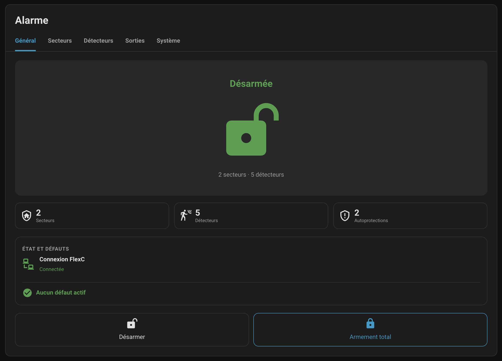
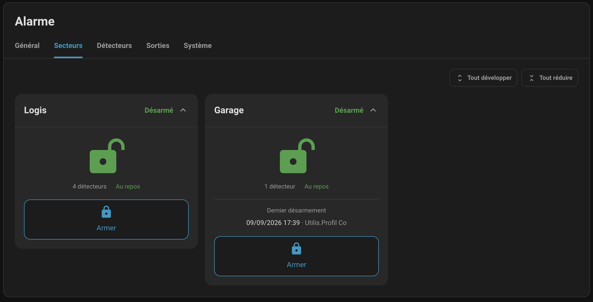
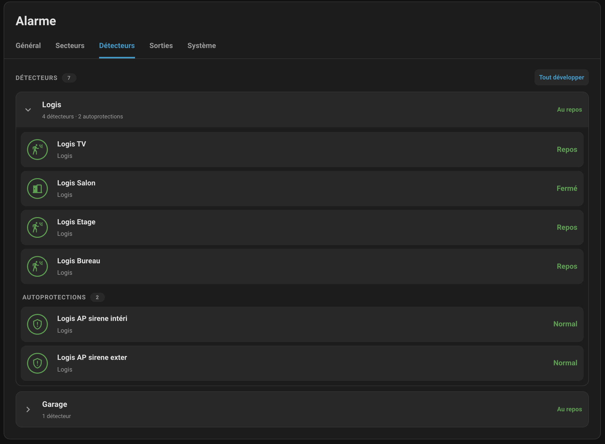
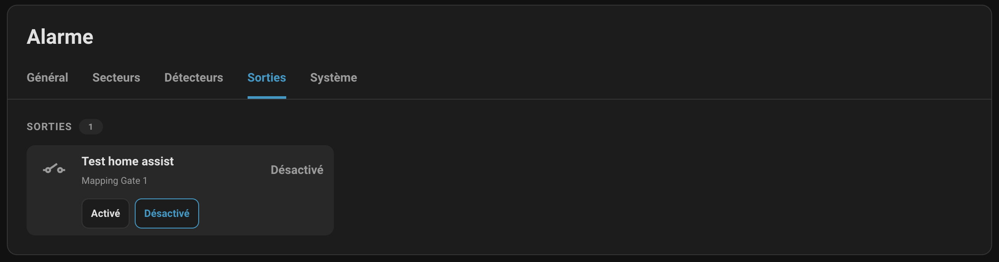
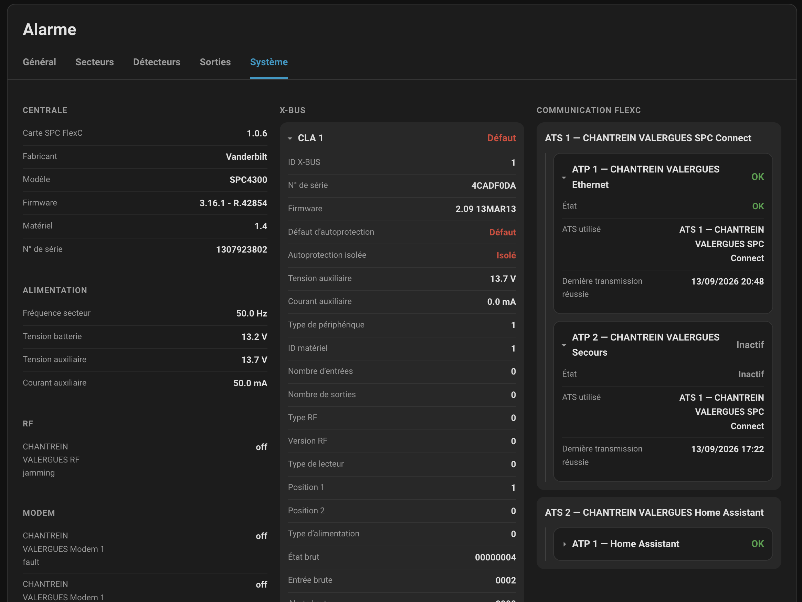

# SPC FlexC

> Native Siemens / Vanderbilt / Comelit SPC alarm integration for Home Assistant using the FlexC protocol.

<p align="center">

[](https://github.com/minimicro34/ha-spc-flexc/releases)
[](https://github.com/minimicro34/ha-spc-flexc/actions/workflows/ci.yml)
[](https://github.com/minimicro34/ha-spc-flexc/actions/workflows/hassfest.yml)
[](https://hacs.xyz/)
[](https://www.home-assistant.io/)
[](https://buymeacoffee.com/minimicro34)
[](LICENSE)

</p>

<p align="center">
  🔐 Alarm control • 🏠 Areas • 🚪 Zones • 🔌 Outputs • 🧩 X-BUS • 📡 FlexC • 🩺 Diagnostics
</p>

---

SPC FlexC is a custom Home Assistant integration for compatible **Siemens / Vanderbilt / Comelit SPC alarm panels**.

It implements a native FlexC receiver directly inside Home Assistant. The SPC panel connects directly to Home Assistant through its FlexC communication path, allowing Home Assistant to retrieve panel information, monitor areas and zones, discover X-BUS hardware, receive events and control supported alarm and output functions without an additional SPC gateway.

> [!IMPORTANT]
> SPC FlexC can change the state of your alarm system.
>
> State-changing commands are never retried blindly after an uncertain communication failure. A bounded retry is only allowed when a fresh SPC status read can first prove that the requested effect was not applied; otherwise the outcome remains uncertain and the command is not replayed. The integration also checks SPC-reported capabilities before sending supported alarm, inhibition and isolation commands.

---

## Contents

- [Features](#features)
- [Supported systems](#supported-systems)
- [Compatibility](#compatibility)
- [Requirements](#requirements)
- [Installation](#installation)
- [SPC configuration](#spc-configuration)
- [Home Assistant configuration](#home-assistant-configuration)
- [Reconfiguration](#reconfiguration)
- [Available entities](#available-entities)
- [SPC FlexC Card](#spc-flexc-card)
- [Alarm control](#alarm-control)
- [Area arming history and user aliases](#area-arming-history-and-user-aliases)
- [Zone inhibition, isolation and restoration](#zone-inhibition-isolation-and-restoration)
- [Mapping Gates / outputs](#mapping-gates--outputs)
- [X-BUS](#x-bus)
- [Diagnostics](#diagnostics)
- [Security recommendations](#security-recommendations)
- [Known limitations](#known-limitations)
- [Troubleshooting](#troubleshooting)
- [Development](#development)
- [Contributing](#contributing)
- [Disclaimer](#disclaimer)
- [Support](#support)
- [License](#license)

---

## Features

### FlexC

- 📡 Native FlexC receiver implemented directly in Home Assistant
- 🔐 AES-256 encrypted FlexC communication
- 🔄 FlexC connection lifecycle management
- 💓 FlexC polling and acknowledgements
- 📥 FLEXML command/reply handling
- ⚡ Processing of unsolicited FlexC events
- 📶 FlexC ATS / ATP communication monitoring
- 🔁 Bounded recovery/retry handling for read-only status requests
- ♻️ Command-timeout recovery through session invalidation, fresh SPC reconnect/handshake/POLL synchronization and a new valid command context

### Alarm

- 🏠 Automatic SPC area discovery
- 🚪 Automatic SPC zone discovery
- 🔓 Individual area Unset / Disarm
- 🔒 Individual area Full Set / Arm Away
- 🏡 Part Set A / Arm Home when supported
- 🌙 Part Set B / Arm Night when supported
- 🛡️ Global Full Set and Global Unset
- ✅ SPC capability prechecks before mode-changing operations
- 🚫 Automatic arming refusal when an area is not ready
- 🚪 Identification of the zone preventing arming when reported by SPC
- 🛠️ Engineer / Installer mode detection
- ⚡ Live state updates from supported FlexC events
- 🚨 Latched `triggered` state for intrusion events (`1000` and `1001`), cleared on confirmed disarming
- 🔎 Triggering zone IDs and names exposed on individual area and aggregate alarm entities
- 🧭 Successive confirmed alarm zones are accumulated; physical input changes during entry delay alone do not mark an intrusion

### Zones

- Live zone state monitoring
- Individual zone binary sensor attributes `intrusion_active` (currently active intrusion) and `intrusion_triggered` (latched until disarming)
- Zone inhibition and de-inhibition controls when explicitly allowed by SPC
- Zone isolation and de-isolation controls when explicitly allowed by SPC
- Zone restoration through a dedicated Home Assistant button when SPC reports `RESTORE_ALLOWED=1`
- Dynamic creation of supported Home Assistant control entities

### X-BUS

- Dynamic discovery of X-BUS peripherals reported by SPC
- Validated identification of tested SPC keypad, comfort keypad, SPCE650, SPCE450 and SPCA210 hardware
- Auxiliary voltage/current information where reported
- Independent X-BUS tamper fault, inhibition and isolation diagnostics with real-time event updates and status reconciliation
- Device-specific metadata retained in Home Assistant diagnostics

### Outputs and access control

- Mapping Gate discovery
- Mapping Gate state monitoring
- Home Assistant switch entities for discovered Mapping Gates
- Resulting output state verification after commands
- Door status monitoring for discovered access-control doors
- Validated door actions: temporary open, permanent open/free access, normal mode and forced lock
- Persistent door-mode verification and bounded timeout recovery

### Home Assistant

- Native `alarm_control_panel` entities
- Zone, switch, sensor and binary sensor entities
- Dynamic entity discovery
- Home Assistant device grouping
- UI configuration and reconfiguration flows
- HACS-compatible repository structure
- English and French translations

---

## Supported systems

SPC FlexC is designed for SPC intrusion panels providing the FlexC protocol, including systems sold under the Siemens SPC, Vanderbilt SPC and Comelit SPC product families.

Actual feature availability depends on the panel model, firmware, installed modules, Command Profile permissions and SPC configuration.

---

## Compatibility

| Component | Supported |
| --- | --- |
| Home Assistant | ✅ |
| HACS | ✅ |
| SPC FlexC | ✅ |
| AES-256 FlexC encryption | ✅ |
| Areas | ✅ |
| Zones | ✅ |
| Full Set / Unset | ✅ |
| Global Full Set / Unset | ✅ |
| Part Set A / B | ✅ When enabled by the area |
| Zone inhibition | ✅ When allowed by SPC |
| Zone isolation | ✅ When allowed by SPC |
| Zone restoration | ✅ When `RESTORE_ALLOWED=1` |
| Mapping Gates / outputs | ✅ |
| X-BUS discovery | ✅ |
| FlexC events | ✅ |
| Intrusion `triggered` state and triggering zone identification | ✅ |
| Per-zone intrusion attributes | ✅ |
| Panel diagnostics | ✅ |
| FlexC ATS / ATP diagnostics | ✅ |

---

## Requirements

You need:

- Home Assistant;
- a compatible SPC panel with FlexC support;
- network connectivity between the SPC panel and Home Assistant;
- an available FlexC ATS / ATP configuration;
- an AES-256 FlexC encryption key;
- a dedicated SPC Command Profile;
- a command username and password.

Home Assistant must be reachable by the SPC panel on the configured FlexC TCP port. The port configured in the SPC ATP and Home Assistant must be identical. A typical port is `52000`, but another available TCP port may be used.

---

## Installation

### HACS

1. Open **HACS → Integrations**.
2. Open the **⋮** menu and select **Custom repositories**.
3. Add `https://github.com/minimicro34/ha-spc-flexc` as an **Integration** repository.
4. Install **SPC FlexC**.
5. Restart Home Assistant.
6. Open **Settings → Devices & services → Add integration → SPC FlexC**.

### Manual installation

Copy `custom_components/spc_flexc` to `/config/custom_components/spc_flexc` and restart Home Assistant.

---

## SPC configuration

### FlexC communication path

Configure an SPC ATS / ATP using FlexC. The SPC panel initiates the TCP connection to Home Assistant, which acts as the FlexC receiver.

Configure the ATP destination with:

- the Home Assistant IP address;
- the TCP port configured in SPC FlexC;
- FlexC encryption enabled;
- the same AES-256 encryption key configured in Home Assistant.

Make sure the destination is reachable, the TCP port is not blocked and the ATS / ATP is enabled.

### Command Profile

Create a dedicated SPC Command Profile. The configuration validated for this integration uses:

```text
Authentication mode: Command User Only
```

On a French SPC interface:

```text
Mode Authentification : Utilisateur Commandes seulement
```

Use dedicated command credentials and enable only the FLEXML permissions required by your installation.

Read permissions are required for the panel and hardware status used by the integration. Alarm control requires area change-mode permissions. Zone inhibition/isolation and Mapping Gate controls additionally require the corresponding commands to be permitted by the Command Profile.

> [!IMPORTANT]
> `SPC User Only / Utilisateur SPC seulement` has not been validated as the authentication mode for this integration.

> [!NOTE]
> **Firmware-specific authentication findings (SPC 3.14.1):** Henrik reported that FlexC accepts usernames of 4–16 characters and web passwords of 6–16 characters, using letters, digits and `. ! @ # $ % _ + - = ; < > ?`. A longer password may still work in the panel's web interface but fail over FlexC with error `54` (authentication failed). These limits have not been confirmed across all SPC firmware versions.
>
> If panel-user credentials produce error `54`, check **Communications → FlexC → ATS Command Profile**: the **Command User or Panel User** setting and the Command Profile's own credentials may affect authentication. This is distinct from the **Command User Only** configuration validated above. See [Henrik's SPC panel setup guide](https://github.com/henrikekblad/spc-flexc-home-assistant/blob/main/docs/panel-setup.md) for details.

---

## Home Assistant configuration

After installation, add **SPC FlexC** from **Settings → Devices & services**.

The configuration flow asks for:

- SPC address;
- FlexC TCP port;
- AES-256 key;
- Command Profile username;
- Command Profile password.

After setup, the SPC panel should establish its FlexC connection to Home Assistant.

---

## Reconfiguration

Connection settings can be changed without removing and recreating the integration.

Open **Settings → Devices & services → SPC FlexC → Reconfigure** to change the SPC address, FlexC TCP port, AES-256 key or Command Profile credentials.

After a successful panel refresh, the SPC panel serial number is used as the stable config-entry unique identifier. This allows the panel IP address to change without changing the logical identity of the SPC installation in Home Assistant.

---

## Available entities

The exact entities depend on the SPC panel, its configuration, capabilities and installed hardware.

### Alarm control panels

An `alarm_control_panel` entity is created for every discovered SPC area, together with a global SPC alarm control panel representing the complete installation.

### Zones

Discovered zones are represented in Home Assistant and are also used to resolve SPC arming refusal reasons. When SPC explicitly reports the relevant capabilities, dedicated switches are dynamically created for zone inhibition and isolation. A dedicated **Restore** button is also created for each zone and becomes available only while SPC explicitly reports `RESTORE_ALLOWED=1`.

### Mapping Gates

Discovered Mapping Gates are represented as Home Assistant switches. Their friendly names are taken from SPC when available.

### X-BUS devices

X-BUS peripherals are dynamically grouped as Home Assistant devices. Tested device families can be identified as SPC keypads, comfort keypads, SPCE650 I/O expanders, SPCE450 output expanders and SPCA210 door controllers. Unknown hardware remains generic rather than being assigned guessed semantics.

### Diagnostics

Diagnostic entities are associated with the appropriate SPC devices and can include panel power/battery/tamper faults, modem/RF information, FlexC ATS/ATP state and X-BUS operational information.

Availability is hardware- and firmware-dependent.

### FlexC event ID diagnostics (optional)

For testing unknown FlexC event IDs (for example WPAN, WRMT or WKP-SIM),
enable the **Last FlexC event ID** diagnostic sensor in Home Assistant under
**Settings → Devices & services → SPC FlexC → Entities**. This sensor is
**disabled by default** to avoid unnecessary state recording.

Its state is the most recent numeric `EV_ID`; attributes expose the matching
`area_id`, `zone_id`, and the **20 most recent** sets of these numeric
identifiers. No raw EVENT XML, user names, passwords or device payloads are
retained in this diagnostic history. The history is in memory only and resets
when the integration reloads. It is intended for event discovery, not a
permanent audit log or an implementation of additional devices.

Routine PIR, EVENT and POLL resynchronization traces are logged at
`DEBUG`, not `INFO`. To capture detailed timing, enable DEBUG logging for
`custom_components.spc_flexc` temporarily.

---

## SPC FlexC Card

Starting with **SPC FlexC v1.1.2**, the validated **SPC FlexC Card v1.0.18**
is bundled with this integration. It is no longer distributed as a separate
HACS Dashboard plugin.

The integration serves the bundled card at
`/spc_flexc/ha-spc-flexc-card.js?v=1.0.18` and automatically registers it as a
Lovelace JavaScript module when resources are managed in storage mode.
The card supports alarm control, areas, detectors, doors, Mapping Gates,
X-BUS and system diagnostics. Use the custom card type
`custom:spc-flexc-card` in your dashboard.

### Screenshots

**General view**



**Areas**



**Detectors**



**Outputs**



**System**



### Migrating from the standalone HACS card

1. Update the SPC FlexC integration and restart Home Assistant.
2. In **Settings → Dashboards → Resources**, verify that the bundled
   `/spc_flexc/ha-spc-flexc-card.js?v=1.0.18` resource is registered.
   If a single legacy HACS resource exists, the integration migrates its
   resource URL automatically.
3. Uninstall the old **SPC FlexC Card** Dashboard repository from HACS.
   Remove any leftover legacy resource entries pointing to
   `/hacsfiles/ha-spc-flexc-card/` or `/local/community/ha-spc-flexc-card/`.
   Avoid loading two copies of the card, which register the same custom element.
4. Reload the browser with a hard refresh. Your existing card configuration
   does not need to be recreated.

If Lovelace uses **YAML-managed resources**, automatic registration is not
possible. Add the bundled URL as a `module` under
`lovelace: resources:` in `configuration.yaml` and remove the old URL.
Do not edit Home Assistant's `.storage` files manually.

### Frontend development

The canonical JavaScript sources and build tooling now live in
[`frontend/`](frontend/). With Node.js 20 or later:

```bash
cd frontend
npm run build
npm run check
```

The build generates
`custom_components/spc_flexc/www/ha-spc-flexc-card.js`. Commit the
generated file with any frontend source changes. The former
[standalone card repository](https://github.com/minimicro34/ha-spc-flexc-card)
is retained as development history.


---

## Alarm control

SPC FlexC maps the validated SPC area modes as follows:

| SPC mode | SPC meaning | Home Assistant |
| ---: | --- | --- |
| `0` | Unset | Disarmed |
| `1` | Part Set A | Armed Home |
| `2` | Part Set B | Armed Night |
| `3` | Full Set | Armed Away |

Part Set controls are only exposed when the corresponding capability is reported by SPC.

### Global alarm control

The global `alarm_control_panel` reports a standard Home Assistant alarm state only when all discovered SPC areas have a consistent, known arming mode. If the areas have different modes, its state is `unknown` because Home Assistant does not define a native mixed arming state. The `arming_summary` attribute explicitly reports `mixed` in that case. It can also report `disarmed`, `armed_away`, `armed_home`, `armed_night` or `unknown` according to the aggregate area modes. If any area mode is unavailable or unrecognized, the global state and `arming_summary` remain `unknown` rather than incorrectly indicating that the installation is disarmed. Individual area alarm entities continue to show their own modes.

Before Global Full Set, every discovered area is prechecked. If any precheck fails, the operation is aborted before the first Full Set command is sent. Only after all prechecks succeed are individual area commands sent.

Global Full Set is therefore coordinated but not atomic. A communication failure or panel state change after prechecks can still produce a partially completed operation. State-changing commands are not automatically retried.

### Arming errors

Validated SPC reasons in the form `1000 + zone_id` identify a zone preventing arming. The integration resolves the zone ID against discovered zones and reports it in the Home Assistant error when possible.

SPC reason `10006` is handled as Engineer / Installer mode preventing the requested arming operation. SPC reason `2007` is handled as an active system fault and known active diagnostic faults are included when available.

Unknown reason codes are preserved and are not assigned guessed meanings.

---

## Area arming history and user aliases

Each individual SPC area `alarm_control_panel` exposes the most recent confirmed arming and disarming events as attributes:

| Arming | Disarming | Meaning |
| --- | --- | --- |
| `last_arm_time` | `last_disarm_time` | SPC event timestamp |
| `last_arm_user_id` | `last_disarm_user_id` | SPC user identifier |
| `last_arm_user_name` | `last_disarm_user_name` | Original user name reported by SPC |
| `last_arm_user_display_name` | `last_disarm_user_display_name` | Display name, using a configured alias when available |

This history is stored and restored after Home Assistant restarts. It is populated from received SPC events, not reconstructed retroactively from older panel events. Existing `last_set_*` and `last_unset_*` attributes remain available.

### Configure user display names

Open **Settings → Devices & services → SPC FlexC → Configure** and find the **User aliases** multiline field. Enter **one mapping per line** in the format `ID=Name`, for example:

```text
1=Alice
2=Bob
9995=Home Assistant
9999=Engineer
```

Press **Enter** after each mapping to start a new line. Do not enter literal `\\n` characters, commas, semicolons, quotes or list markers. No spaces are needed around `=`; spaces **within a display name** are allowed. The ID must be a numeric SPC user ID, and each name must be non-empty. Save the options to apply the aliases, including to previously recorded area history.

Aliases only affect the `*_user_display_name` attributes. The original `*_user_name` and `*_user_id` attributes are preserved. Display names use the configured alias first, then a user name retrieved from SPC when available, then the name supplied by the event.

**Important:** An event attributed to the SPC Command Profile (for example user ID `9995`) identifies the technical command account, not necessarily the individual who initiated the operation in Home Assistant. An alias such as `9995=Home Assistant` is a display label, not proof of a person's identity.

---

## Zone inhibition, isolation and restoration

SPC FlexC exposes zone inhibition and isolation controls only when the SPC panel explicitly reports the corresponding capability. Zone restoration is likewise exposed only when the zone status explicitly reports `RESTORE_ALLOWED=1`.

Real-panel testing validated:

| Action | Meaning |
| ---: | --- |
| `0` | Inhibit |
| `1` | De-inhibit |
| `2` | Isolate |
| `3` | De-isolate |
| `4` | Restore |

`ISOLATED=1` is used as the canonical reported zone isolation state. `ISOLATE_ALLOWED=1` and `DEISOLATE_ALLOWED=1` are used as the corresponding capability fields.

The integration does not infer permission from unrelated status values. If the expected capability is not explicitly reported, the state-changing command is not sent.

Zone restore action `4` was validated end-to-end on an SPC4300: a zone at physical rest with a latched alarm reported `RESTORE_ALLOWED=1`; the restore command returned `RESULT=0`, the subsequent zone status returned to normal and `RESTORE_ALLOWED` disappeared. After a restore request, SPC FlexC rereads the zone status and only considers the operation complete once SPC no longer reports restoration as allowed.

---

## Mapping Gates / outputs

SPC Mapping Gates discovered through FLEXML are exposed as Home Assistant switches.

The integration:

1. discovers the available Mapping Gates;
2. tracks their reported state;
3. sends the requested state change;
4. refreshes Mapping Gate status;
5. confirms the resulting state reported by SPC.

If a Mapping Gate control times out, the timed-out FlexC session is invalidated. The integration waits for the SPC to reconnect and establish a fresh handshake/POLL command context before reading Mapping Gate status again.

If the requested state is already reported, the timed-out command is treated as applied and is not repeated. If the fresh status explicitly proves that the requested state was not applied, the control is retried once and its resulting state is verified. If the result cannot be determined unambiguously, the command is not replayed.

A command is rejected when the Mapping Gate is unknown or the requested state cannot be confirmed.

---

## X-BUS

SPC FlexC dynamically discovers X-BUS peripherals reported by the panel.

Validated mappings currently include:

- SPC keypad;
- SPC comfort keypad;
- SPCE650 I/O expander;
- SPCE450 output expander;
- SPCA210 door controller.

Operational entities can include auxiliary voltage/current and independent tamper fault, inhibition and isolation states. Validated keypad tamper inhibition/isolation events update Home Assistant immediately, while periodic X-BUS status polling reconciles the reported state if an event is missed. Lower-level hardware identifiers and raw protocol values remain available in diagnostics where useful.

Unknown or unvalidated values are deliberately not given speculative meanings.

X-BUS control is not exposed unless the corresponding write semantics have been validated.

---

## Diagnostics

Depending on the panel, firmware and installed hardware, SPC FlexC can expose information related to:

- panel identity and firmware;
- panel operating state and summary;
- 230 V mains, battery and enclosure tamper faults;
- modem and RF information where reported;
- area information and last Set/Unset data;
- FlexC ATS / ATP communication state;
- X-BUS peripheral identity and status;
- X-BUS auxiliary power values;
- X-BUS tamper fault, inhibition and isolation states;
- raw protocol metadata retained for troubleshooting.

Some states are updated immediately from unsolicited FlexC events. Missing optional fields are tolerated because not every SPC installation exposes the same diagnostics.

---

## SPC command attribution

When FLEXML commands use **Command User Only** authentication, SPC can attribute Set/Unset operations to its internal Command Profile user. The SPC event log may still identify the ATS / ATP and Command Profile as the technical origin.

This behaviour is generated by the SPC panel and is not a Home Assistant user mapping.

---

## Security recommendations

SPC FlexC controls security equipment. Use a dedicated FlexC AES-256 key, a dedicated Command Profile, unique command credentials and only the permissions required by the integration. Restrict network access to the FlexC listener and keep another method of controlling the alarm available.

Never publish FlexC encryption keys, Command Profile passwords, SPC user PINs or installer codes in issues, logs, diagnostics or screenshots.

Do not expose the FlexC listener directly to the Internet.

---

## Known limitations

### PIR event updates and beta diagnostics

On supported motion zones (SPC zone types `0` and `2`), FlexC event `2100` updates the Home Assistant motion state immediately, while event `2101` restores it. The event must identify a known zone and match its area. This event-driven path does not wait for the next zone status poll.

Zone polling remains enabled to reconcile state. If an EVENT arrives while a zone-status batch is being read, the integration preserves the newer event-driven motion state rather than overwriting it with a potentially stale poll result. This behavior was validated through live PIR testing and regression tests for v1.1.4.

**Diagnostic logging:** Detailed PIR, EVENT and POLL context traces are emitted at `DEBUG` (not `INFO`). Enable `custom_components.spc_flexc` DEBUG logging temporarily when investigating a problem:

- `FlexC EVENT diagnostic`: incoming event ID, zone ID and area ID (not raw credentials).
- `FlexC zone EVENT state`: motion state applied from event `2100` or `2101`.
- `FlexC PIR diagnostic`: changes detected by polling, including logic input, actuation counters and timing.
- `FlexC PIR publish diagnostic`: processing and Home Assistant publication timings.
- `FlexC unsolicited EVENT between commands`: the command context was invalidated while idle.
- `FlexC context resynchronized from SPC POLL`: a fresh POLL restored the command context; `wait_ms` measures the EVENT-to-POLL delay.

A slow zone polling cycle emits `FlexC PIR poll slow` at `WARNING`, with `interval_ms`, `lock_wait_ms`, `read_ms` and per-batch durations. Command timeouts and connection/protocol errors retain their existing warning diagnostics.

**Protocol safety:** An unsolicited EVENT between commands invalidates the existing command context. The next command waits for a fresh SPC POLL before proceeding. These beta diagnostics measure the remaining EVENT-to-POLL wait; the transport still requires a validated fresh POLL before the next command. Zone polling now releases the coordinator operation lock between batches, allowing other operations to run between batches rather than waiting for the full scan. This improves scheduling opportunities but does **not** shorten the panel's EVENT-to-POLL protocol interval. The `FlexC command context wait after EVENT` diagnostic measures how long an actual command was blocked; `lock_wait_ms` now sums lock acquisition delays across zone batches. EVENTs received while a command is in flight do not replace its reply context.

For a hardware test, compare `2100` / `2101` timestamps with the Home Assistant motion entity transitions, then inspect `wait_ms` and `FlexC PIR poll slow` warnings. Do not share credentials, encryption keys or raw sensitive protocol payloads in logs or issues.

### Intrusion event tracking

FlexC intrusion event `1000` marks an armed area as `triggered` and records the triggering zone. A zone restore event `1100` can clear its active intrusion indication, but the area alarm and the zone's `intrusion_triggered` attribute remain latched until confirmed disarming. Area and aggregate `alarm_control_panel` entities expose `alarm_event_active`, `alarm_zone_ids`, and `alarm_zones` (zone IDs and names). Each individual zone binary sensor exposes `intrusion_active` and `intrusion_triggered` attributes without changing its normal on/off state.

The intrusion latch is retained across normal polling and same-arming-mode reconnections while Home Assistant is running. Intrusions occurring entirely while Home Assistant is disconnected or restarting may not be reconstructed from subsequent status polling.


### Global Full Set is not atomic

Global Full Set coordinates individual area operations. All areas are prechecked first, but a later communication failure or panel state change can still result in an incomplete operation. State-changing commands are not blindly retried after an uncertain result. Automatic recovery is only used for operations whose resulting SPC state can be verified unambiguously.

### Door-control timeout recovery

Door actions 6 (permanent open/free access), 7 (normal mode) and 8 (forced lock) have persistent, verifiable target modes. After a control timeout, SPC FlexC recovers the FlexC session and reads the current door status before deciding whether any replay is safe.

If the requested mode is already reported, the timed-out command is treated as applied and is not repeated. If the fresh status reports another known persistent mode, the control is retried once and the final mode is verified. If the resulting mode is unknown or ambiguous, the command is not replayed.

Action 5 (temporary open) remains deliberately non-replaying after a timeout because the persistent door mode cannot prove whether the temporary pulse has already been executed.

### Hardware-dependent diagnostics

Entity and diagnostic availability depends on panel model, firmware, installed modules and configuration.

### X-BUS topology

X-BUS discovery reflects the peripherals returned by the SPC FlexC/FLEXML interface. If a panel does not return a peripheral in the available status data, Home Assistant cannot represent it from that response.

### Unvalidated protocol fields

Unknown values are retained for diagnostics rather than assigned guessed semantics. Additional hardware and write operations are added only when their behaviour is sufficiently validated.

---

## Troubleshooting

### SPC does not connect

Check the Home Assistant destination configured in the SPC ATP, FlexC TCP port, firewall rules, ATS / ATP enabled state, AES-256 configuration and network connectivity. Remember that the SPC panel initiates the connection to Home Assistant.

### FlexC connects but FLEXML commands fail

Check the Command Profile authentication mode, command username/password and command permissions.

### Arming fails

Use the Home Assistant error message and individual area/zone states. If a blocking zone or SPC reason is reported, correct the panel condition before retrying.

### Dynamic hardware is missing

Check Home Assistant diagnostics and the raw SPC/FLEXML data first. Hardware-dependent entities can only be created for objects actually returned by SPC.

---

## Development

For the ongoing **v1.1.5 development branch**, including the protocol review from issue #11, planned beta changes and validation status, see [v1.1.5 development notes](docs/v1.1.5-development.md). The stable release remains v1.1.4 until these changes are validated.

Development instructions are documented in [CONTRIBUTING.md](CONTRIBUTING.md).

The main validation commands are:

```bash
make format
make check
make coverage
```

`make format` applies Ruff formatting.

`make check` runs compilation, formatting verification, linting, type checking and the test suite. It **does not** run the coverage gate.

`make coverage` runs the tests with pytest-cov and enforces the repository minimum coverage threshold.

Before a pull request or release, run both:

```bash
make check
make coverage
git diff --check
```

The current coverage gate is 80%. The v1.1.1 release validation reached 90.08% total coverage.

---

## Contributing

Contributions are welcome. Please read [CONTRIBUTING.md](CONTRIBUTING.md) before submitting changes.

Useful contributions include bug fixes, additional SPC hardware validation, diagnostics, FlexC/FLEXML support, event decoding, tests, translations and documentation.

For protocol semantics, prefer real-panel evidence or reliable documentation. Do not assign meanings to unknown fields solely from names or observed numeric coincidences.

> [!WARNING]
> Never publish FlexC encryption keys, Command Profile passwords, SPC user PINs, installer codes or other alarm credentials.

---

## Disclaimer

SPC FlexC is an independent open-source project. It is not affiliated with, endorsed by, or supported by Siemens, Vanderbilt, Comelit or Home Assistant.

Alarm systems are security equipment. Always validate the behaviour of your specific panel and installation before relying on remote alarm control.

The authors and contributors cannot be held responsible for alarm activations, failed arming operations, missed events or other consequences resulting from use of this integration.

---

## Support

If you find SPC FlexC useful and would like to support its development, you can buy me a coffee.

<p align="center">
  <a href="https://buymeacoffee.com/minimicro34">
    
  </a>
</p>

Bug reports, feature suggestions, contributions and GitHub stars are also appreciated. Please use GitHub Issues for bug reports and feature requests and include the panel model, firmware, integration version, Home Assistant version, relevant logs and diagnostics when possible — without credentials or encryption keys.

---

## License

Copyright © 2026 minimicro34.

This project is licensed under the [GNU General Public License v3.0 or later](LICENSE).


### Bundled card regression checks

The SPC FlexC Lovelace card is bundled with this integration, not installed as a separate HACS dashboard repository. Its canonical JavaScript sources live in `frontend/src/`, and the generated resource is `custom_components/spc_flexc/www/ha-spc-flexc-card.js`.

To validate the bundled card, use `make card-test` (Node.js regression tests) and `cd frontend && npm ci && npm run check` (JavaScript syntax and generated bundle consistency). `make check` includes the card regression tests alongside Python checks; CI also runs the frontend bundle check and `make coverage`.

Diagnostic FlexC event classifications are historical observations, not persistent alarm states. The optional last-event diagnostic sensor may expose `alarm_type` and `alarm_transition` for validated keypad and user alarm events; these fields must not be interpreted as proof that an alarm is still active.
